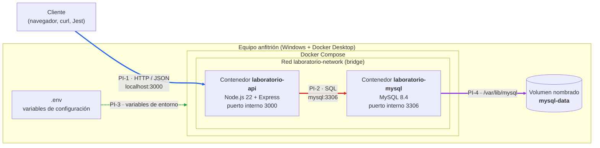
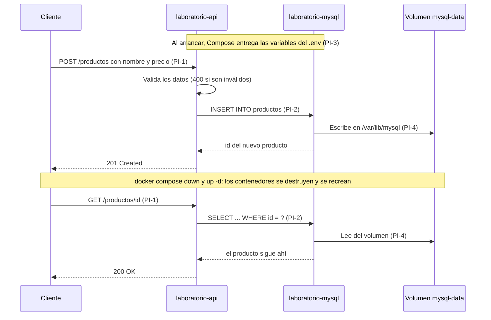

# Arquitectura del laboratorio

**Tema 9 — Pruebas de una arquitectura basada en contenedores**
Enfoque: integración y ejecución de componentes aislados.

> **Idea central:** cada componente del sistema (API y base de datos) corre en su propio contenedor, aislado de los demás. Docker Compose los conecta con una red, les entrega la configuración y guarda los datos en un volumen. Lo que se prueba son esas **conexiones**: comunicación, configuración, persistencia y recuperación cuando un componente cae.

---

## 1. Qué exige el tema

La guía pide levantar una API, una base de datos y sus dependencias en contenedores, y demostrar cuatro cosas:

| Exigencia | Qué significa en este laboratorio | Punto de integración |
|---|---|---|
| **Comunicación** | La API recibe peticiones y habla con MySQL | PI-1, PI-2 |
| **Configuración** | Los contenedores toman usuario, contraseña y puertos del `.env` | PI-3 |
| **Persistencia** | Los datos sobreviven aunque se destruya el contenedor de MySQL | PI-4 |
| **Recuperación** | Si MySQL cae, la API responde con un error controlado y se recupera sola cuando MySQL vuelve | PI-2 |

---

## 2. Diagrama de arquitectura

**Cómo leerlo:**

- **PI-1 (azul):** el cliente entra desde fuera de Docker por el puerto publicado `3000`.
- **PI-2 (rojo):** la API llega a MySQL por la red interna, usando el **nombre del servicio** `mysql`, no `localhost`.
- **PI-3 (verde):** el `.env` llega al **borde de Compose**, porque Compose lo lee y reparte las variables a **los dos** contenedores.
- **PI-4 (morado):** el volumen está **fuera** de Compose, porque sobrevive aunque los contenedores se destruyan.

---

## 3. Componentes

| Componente | Imagen / origen | Puerto (anfitrión → contenedor) | Responsabilidad | ¿Guarda datos? |
|---|---|---|---|---|
| `laboratorio-api` | Construida desde `api/Dockerfile` (base `node:22-alpine`) | `3000 → 3000` | Recibe peticiones HTTP, valida los datos y consulta MySQL | No (efímero) |
| `laboratorio-mysql` | `mysql:8.4` (imagen oficial) | `3313 → 3306` | Guarda la tabla `productos` | No por sí mismo: usa el volumen |
| `laboratorio-network` | Red bridge creada por Compose | — | Conecta los contenedores y resuelve sus nombres | No |
| `mysql-data` | Volumen nombrado creado por Compose | — | Conserva los archivos de la base de datos | **Sí** |
| `.env` | Copia de `.env.example` (no se sube al repo) | — | Define puertos, usuario, contraseñas y nombre de la base | — |
| `mysql/init.sql` | Script del repositorio | — | Crea la tabla e inserta 3 productos de ejemplo, **solo** cuando el volumen está vacío | — |

### Endpoints de la API

| Método y ruta | Respuesta esperada |
|---|---|
| `GET /` | `200` con mensaje de bienvenida |
| `GET /health` | `200` con `{ "estado": "OK" }` ⏳ *(con el ajuste A6: `503` si MySQL no responde)* |
| `GET /productos` | `200` con la lista · `503` si MySQL no responde |
| `GET /productos/:id` | `200` con el producto · `404` si no existe · `503` si MySQL no responde |
| `POST /productos` | `201` con el producto creado · `400` si los datos son inválidos · `503` si MySQL no responde |

---

## 4. Puntos de integración

Un **punto de integración** es un lugar donde dos partes del sistema se conectan. Ahí es donde más fallas aparecen, y por eso es donde se enfocan las pruebas.

| ID | Integración | Qué viaja | Por dónde | Qué lo define en `docker-compose.yml` |
|---|---|---|---|---|
| **PI-1** | Anfitrión → API | Peticiones HTTP (`GET`, `POST`) y respuestas en JSON con su código de estado | Puerto publicado: `localhost:3000` del anfitrión hacia el `3000` del contenedor | `ports` del servicio `api`: `"${API_PORT}:3000"` (líneas 7-8) |
| **PI-2** | API → MySQL | Consultas SQL (`SELECT`, `INSERT`) y sus resultados, por el protocolo de MySQL | Red interna `laboratorio-network`; la API resuelve el nombre de servicio `mysql` y se conecta al puerto `3306` | `networks` de ambos servicios (líneas 21-22 y 41-42), red declarada (47-49), `DB_HOST` y `DB_PORT` (12-13), `depends_on` (18-19) |
| **PI-3** | `.env` → contenedores | Variables de configuración: host, puerto, nombre de la base, usuario y contraseña | Compose lee el `.env` del anfitrión, sustituye los `${...}` y los entrega como variables de entorno a cada contenedor | `environment` del servicio `api` (líneas 10-16) y del servicio `mysql` (28-32) |
| **PI-4** | MySQL → volumen | Los archivos de datos de MySQL (tablas y registros) | El volumen `mysql-data` montado en `/var/lib/mysql` dentro del contenedor | `volumes` del servicio `mysql` (líneas 37-38) y volumen declarado (44-45) |

> ⏳ Los números de línea corresponden al compose actual y cambian cuando R1 agregue `name:` y el healthcheck.

### Flujo completo de una petición

Así se ven los cuatro puntos trabajando juntos cuando se crea un producto y luego se consulta después de recrear los contenedores:

---

## 5. Riesgos por punto de integración

Un riesgo por cada punto de integración, con los casos de prueba que lo cubren. Los casos están detallados en [`matriz-casos.md`](matriz-casos.md) (R3).

| ID | Punto | Riesgo | Qué pasaría si ocurre | Casos que lo cubren |
|---|---|---|---|---|
| **RG-1** | PI-1 | La API no es alcanzable desde el anfitrión, o responde con un contrato distinto al esperado (otro código HTTP u otro formato de JSON) | El cliente no puede usar el sistema o interpreta mal las respuestas | CP-01, CP-02, CP-03 |
| **RG-2** | PI-2 | MySQL se cae o todavía no está listo, y la API se cuelga o diagnostica mal el error | La API deja de responder o da un error que no explica la causa real | CP-01, CP-02, CP-03, CP-04, CP-05 |
| **RG-3** | PI-3 | Una variable de entorno errónea (por ejemplo, la contraseña) deja a la API sin acceso a la base de datos | El sistema arranca "bien" pero ninguna consulta funciona | CP-07 |
| **RG-4** | PI-4 | Los datos se pierden al recrear el contenedor de MySQL | Se borra toda la información guardada | CP-06 |

> **PI-2 (API → MySQL) es el punto más crítico:** lo cubren 5 de los 7 casos, porque es donde la API depende de otro contenedor que puede no estar disponible.

### Evidencia de los riesgos en el laboratorio actual

Al ejecutar el laboratorio, **antes** de los ajustes de R1, se observó lo siguiente. Muestra que los riesgos no son teóricos:

| Observación | Riesgo | Estado |
|---|---|---|
| Justo después de `docker compose up`, la API registra `ECONNREFUSED ...:3306` y responde `503` durante unos segundos: `depends_on` espera a que el contenedor de MySQL **arranque**, no a que **acepte conexiones** | RG-2 | ⏳ Lo corrige el ajuste A2 (healthcheck + `service_healthy`) |
| Con `docker stop laboratorio-mysql`, `/productos` responde `503 "Base de datos no disponible"` y la API **sigue en ejecución** | RG-2 | Comportamiento correcto; lo validan CP-04 y CP-05 |
| Con MySQL detenido, `/health` sigue respondiendo `200 "OK"`, así que reporta un estado falso | RG-2 | ⏳ Lo corrige el ajuste A6 |
| Al volver a iniciar MySQL, la API se recupera **sola**, sin reiniciarla | RG-2 | Comportamiento correcto; lo valida CP-05 |
| Tras `docker compose down` y `up -d`, un producto creado antes sigue consultable | RG-4 | Comportamiento correcto; lo valida CP-06 |

### Otros riesgos fuera del alcance de la estrategia

Se identificaron, pero no tienen caso de prueba porque la estrategia los excluye o porque son de bajo impacto en un laboratorio local:

- **`init.sql` no se vuelve a ejecutar** si el volumen ya tiene datos, así que un cambio en el script no se aplica a una base existente.
- **Puertos ocupados** en el anfitrión (`3000` o `3313`): el contenedor no arranca.
- **`docker compose down -v`** borra el volumen y con él todos los datos: es una acción deliberada, no una falla.
- **Seguridad:** las contraseñas están en texto plano en `.env` y `root` es accesible por el puerto `3313`. La seguridad está fuera del alcance.

---

## 6. Conceptos de contenedores

**Imagen y contenedor.** Una **imagen** es una plantilla de solo lectura que trae todo lo necesario para ejecutar un programa: sistema base, librerías y código. Un **contenedor** es una instancia de esa imagen en ejecución, aislada de los demás procesos del equipo. En el laboratorio, `mysql:8.4` es una imagen oficial que se descarga tal cual, y la imagen de la API se construye con `api/Dockerfile`. De cada una sale un contenedor: `laboratorio-mysql` y `laboratorio-api`. Un contenedor se puede borrar y recrear desde su imagen en segundos, y por eso se dice que es **efímero**.

**Red de Compose y nombre de servicio.** Docker Compose crea una red privada (`laboratorio-network`, de tipo bridge) y conecta a ella los dos contenedores. Dentro de esa red, cada contenedor encuentra a los demás **por el nombre del servicio**, gracias a un DNS interno de Docker. Por eso la API se conecta a `mysql:3306` y no a una IP ni a `localhost`: dentro del contenedor de la API, `localhost` es el propio contenedor. El puerto `3313` solo sirve para entrar a MySQL desde Windows, no para la comunicación entre contenedores (PI-2).

**Volumen nombrado.** Es un espacio de almacenamiento que Docker administra **fuera** del contenedor. En el laboratorio, el volumen `mysql-data` se monta en `/var/lib/mysql`, que es donde MySQL guarda sus archivos. Así, cuando `docker compose down` destruye el contenedor de MySQL, los datos quedan en el volumen y el nuevo contenedor los vuelve a usar. Solo `docker compose down -v` borra el volumen (PI-4).

**Variables de entorno.** Son valores de configuración que se entregan al contenedor desde fuera, sin cambiar el código ni la imagen. Compose lee el archivo `.env`, reemplaza los `${...}` del `docker-compose.yml` y pasa el resultado a cada contenedor. MySQL usa `MYSQL_USER` y `MYSQL_PASSWORD` para crear el usuario, y la API usa `DB_USER` y `DB_PASSWORD` para conectarse con ese mismo usuario. Si no coinciden, la API no puede entrar a la base de datos, aunque los dos contenedores estén en ejecución (PI-3). Una variable definida en la terminal tiene prioridad sobre la del `.env`, y eso es lo que usa CP-07.

**Healthcheck.** Es un comando que Docker ejecuta periódicamente dentro de un contenedor para saber si el servicio está **listo**, no solo **en ejecución**. Sin él, Compose da por arrancado a MySQL apenas inicia el contenedor, aunque MySQL todavía no acepte conexiones. Con un healthcheck y `depends_on: condition: service_healthy`, Compose espera a que MySQL responda antes de arrancar la API. ⏳ *El compose actual no tiene healthcheck; lo agrega R1 con el ajuste A2.*

---

## 7. Decisiones de arquitectura

| Decisión | Motivo |
|---|---|
| Dos contenedores: API y base de datos | La guía pide un laboratorio pequeño, de 2 a 3 componentes; es el mínimo que permite probar una integración real |
| `node:22-alpine` y `mysql:8.4` con versión fija | Imágenes oficiales y livianas; con la versión fija, todos los integrantes ejecutan exactamente lo mismo |
| `container_name` fijo | Permite ejecutar `docker stop laboratorio-mysql` en las pruebas de caída desde cualquier carpeta |
| Puerto externo `3313` para MySQL | Evita el conflicto con un MySQL instalado en el equipo que ya use el `3306` |
| Usuario de aplicación distinto de `root` | La API usa `laboratorio_user`; `root` queda solo para administración |
| Volumen nombrado `mysql-data` | Los datos no dependen del ciclo de vida del contenedor |
| La API responde `503` cuando MySQL falla | La API no se cae: informa que su dependencia no está disponible |
| Configuración en `.env` | La misma imagen sirve con otra configuración sin cambiar el código |

### Alcance y limitaciones

- Se ejecuta **solo en local** con Docker Desktop; no hay despliegue en la nube.
- No incluye orquestadores (Kubernetes), balanceo de carga ni varias réplicas.
- La seguridad está simplificada a propósito: credenciales de prueba y sin TLS.
- Todos los datos son ficticios.

---

## 8. Resumen

1. **Dos componentes aislados:** la API (Node.js) y la base de datos (MySQL), cada uno en su contenedor.
2. **Docker Compose como pegamento:** crea la red y el volumen y entrega la configuración.
3. **Cuatro puntos de integración:** PI-1 (anfitrión → API), PI-2 (API → MySQL), PI-3 (`.env` → contenedores) y PI-4 (MySQL → volumen).
4. **Un riesgo por punto**, cubierto por los 7 casos de prueba. El más crítico es PI-2.

Las fuentes consultadas están en [`referencias.md`](referencias.md).
