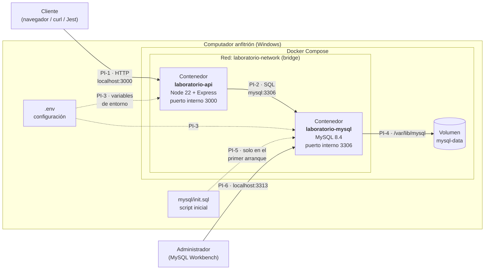
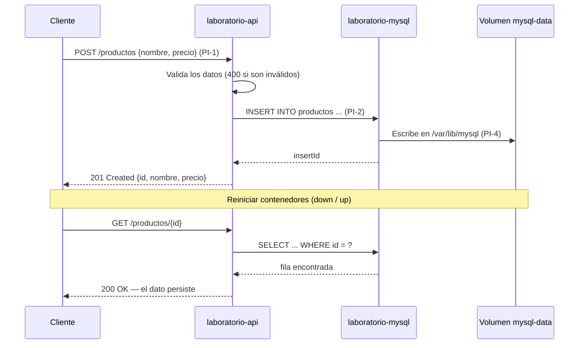
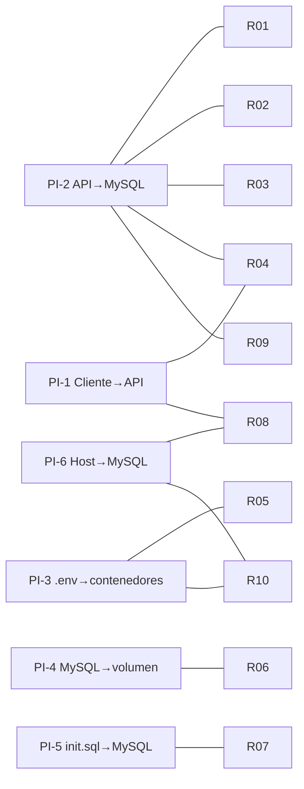

# Arquitectura del laboratorio

**Tema 9 — Pruebas de una arquitectura basada en contenedores**
Enfoque: integración y ejecución de componentes aislados.

> **Idea central:** cada componente del sistema (API y base de datos) corre en su propio contenedor, aislado de los demás. Docker Compose los conecta mediante una red, les entrega la configuración y guarda los datos en un volumen. Lo que se prueba es que esas **conexiones** funcionen: comunicación, configuración, persistencia y recuperación cuando un componente cae.

---

## 1. ¿Qué es una arquitectura basada en contenedores?

Es una forma de organizar un sistema en la que cada componente se empaqueta junto con todo lo que necesita para ejecutarse (código, librerías, sistema base) en una **imagen**. Desde esa imagen se crean **contenedores**: procesos aislados que se ejecutan igual en cualquier computador que tenga Docker.

En este laboratorio:

- La **API** (Node.js + Express) es un contenedor.
- La **base de datos** (MySQL) es otro contenedor.
- **Docker Compose** los levanta juntos con un solo comando y define cómo se conectan.

**¿Por qué es importante probarla?** Cada componente puede funcionar perfecto por separado y aun así el sistema puede fallar por la forma en que se integran: un nombre de red mal escrito, una variable de entorno faltante, un volumen que no se montó o un contenedor que arrancó antes de que el otro estuviera listo.

---

## 2. Diagrama de arquitectura



**Cómo leerlo:**

- Las **flechas sólidas** son comunicación en tiempo de ejecución: peticiones HTTP, consultas SQL y escritura en disco.
- Las **flechas punteadas** son configuración que se entrega al arrancar.
- Los códigos **PI-1 … PI-6** son los puntos de integración que se explican en la sección 4.

### Vista simplificada de puertos

```text
   Windows (host)                       Dentro de Docker
 ┌──────────────────┐            ┌──────────────────────────┐
 │ localhost:3000 ──┼──────────► │ laboratorio-api   :3000  │
 │                  │            │        │                 │
 │                  │            │        │ mysql:3306      │
 │                  │            │        ▼                 │
 │ localhost:3313 ──┼──────────► │ laboratorio-mysql :3306  │
 └──────────────────┘            └──────────────────────────┘
```

> La API **no** usa `localhost:3313` para hablar con MySQL. Dentro de Docker, `localhost` es el propio contenedor de la API. Por eso usa el nombre del servicio, `mysql`, y el puerto interno `3306`.

---

## 3. Componentes

| Componente | Tipo | Imagen / origen | Puerto (host → contenedor) | Responsabilidad | ¿Guarda estado? |
|---|---|---|---|---|---|
| `laboratorio-api` | Contenedor | Construida desde `api/Dockerfile` (base `node:22-alpine`) | `3000 → 3000` | Recibe peticiones HTTP, valida datos y consulta MySQL | No (efímero) |
| `laboratorio-mysql` | Contenedor | `mysql:8.4` (oficial) | `3313 → 3306` | Almacena la tabla `productos` | No por sí mismo: usa el volumen |
| `mysql-data` | Volumen Docker | Creado por Compose | — | Conserva los archivos de la base de datos aunque se borre el contenedor | **Sí** |
| `laboratorio-network` | Red bridge | Creada por Compose | — | Conecta los contenedores y resuelve nombres (`mysql`, `api`) | No |
| `.env` | Archivo de configuración | Copia de `.env.example` | — | Define puertos, usuario, contraseñas y nombre de la base | — |
| `mysql/init.sql` | Script SQL | Repositorio | — | Crea la tabla `productos` e inserta 3 registros de ejemplo | — |

### Endpoints que expone la API

| Método | Ruta | Respuesta esperada |
|---|---|---|
| GET | `/` | `200` — mensaje de bienvenida |
| GET | `/health` | `200` — `{ "estado": "OK" }` |
| GET | `/productos` | `200` — lista de productos · `503` si la BD no responde |
| GET | `/productos/:id` | `200` — producto · `404` si no existe · `503` si la BD no responde |
| POST | `/productos` | `201` — producto creado · `400` si los datos son inválidos · `503` si la BD no responde |

---

## 4. Puntos de integración

Un **punto de integración** es un lugar donde dos partes del sistema se conectan. Es justamente donde más fallas aparecen y donde se enfocan las pruebas de integración.

| ID | Integración | ¿Cómo se conectan? | ¿Qué debe funcionar? | Archivo donde se define |
|---|---|---|---|---|
| **PI-1** | Cliente → API | HTTP por el puerto publicado `3000:3000` | La API responde desde fuera de Docker | `docker-compose.yml` (`ports`) |
| **PI-2** | API → MySQL | Red interna, nombre de servicio `mysql`, puerto `3306`, pool de conexiones `mysql2` | La API lee y escribe en la base de datos | `docker-compose.yml`, `api/src/db.js` |
| **PI-3** | `.env` → contenedores | Compose lee `.env` y lo pasa como variables de entorno | Ambos contenedores usan las mismas credenciales | `.env`, `docker-compose.yml` (`environment`) |
| **PI-4** | MySQL → volumen | El volumen `mysql-data` se monta en `/var/lib/mysql` | Los datos sobreviven a `docker compose down` | `docker-compose.yml` (`volumes`) |
| **PI-5** | `init.sql` → MySQL | Se monta en `/docker-entrypoint-initdb.d/` | La tabla y los datos iniciales existen al primer arranque | `docker-compose.yml`, `mysql/init.sql` |
| **PI-6** | Host → MySQL | Puerto publicado `3313:3306` | Se puede administrar la BD desde Windows | `docker-compose.yml` (`ports`) |

### Flujo completo de una petición (prueba de sistema)



---

## 5. Riesgos identificados

Cada riesgo está ligado a un punto de integración y sugiere qué se debería probar. Los marcados con 🔎 **ya se observaron** al ejecutar el laboratorio.

| ID | Riesgo | PI | ¿Qué pasa? | Impacto | Cómo se prueba / mitiga |
|---|---|---|---|---|---|
| **R-01** 🔎 | La API arranca antes de que MySQL esté listo | PI-2 | `depends_on` solo espera a que el contenedor **inicie**, no a que MySQL **acepte conexiones**. Los logs muestran `ECONNREFUSED` y la API responde `503` durante los primeros segundos | Medio | Prueba: consultar `/productos` justo después de `up`. Mitigación: `healthcheck` en MySQL + `depends_on: condition: service_healthy` |
| **R-02** 🔎 | MySQL se cae mientras la API está activa | PI-2 | La API responde `503 "Base de datos no disponible"` sin caerse; al volver MySQL se recupera sola (el pool crea conexiones nuevas) | Alto | Prueba: `docker stop laboratorio-mysql` → esperar `503`; `docker start` → esperar `200` |
| **R-03** 🔎 | `/health` dice "OK" aunque la BD esté caída | PI-2 | El endpoint no consulta MySQL, así que reporta un estado falso | Medio | Prueba: detener MySQL y llamar `/health`. Mitigación: que `/health` haga `SELECT 1` |
| **R-04** 🔎 | Un contenedor cae y no vuelve a levantarse | PI-1, PI-2 | Ningún servicio tiene política de reinicio (`RestartPolicy = no`) | Alto | Prueba: matar el proceso y verificar el estado. Mitigación: `restart: unless-stopped` |
| **R-05** | Configuración incorrecta | PI-3 | Si falta `.env`, si las contraseñas de API y MySQL no coinciden o si se usa `DB_HOST=localhost`, la API no conecta | Alto | Prueba: levantar con credenciales erróneas y esperar `503` |
| **R-06** | Pérdida de datos | PI-4 | `docker compose down -v` borra el volumen; sin volumen, los datos mueren con el contenedor | Alto | Prueba: insertar → `down` → `up` → el dato sigue (y documentar que `-v` lo borra) |
| **R-07** | `init.sql` no se vuelve a ejecutar | PI-5 | MySQL solo lo ejecuta si el volumen está vacío; un cambio en el script no se aplica a una BD existente | Bajo | Prueba: modificar el script y verificar; solución: `down -v` en ambiente de pruebas |
| **R-08** | Puerto ocupado en el host | PI-1, PI-6 | Si 3000 o 3313 están en uso, el contenedor no arranca | Bajo | Mitigación: cambiar el puerto externo en `.env` / compose |
| **R-09** 🔎 | Tipos de dato inconsistentes | PI-2 | `GET` devuelve `precio` como texto (`"85000.00"`, por ser `DECIMAL`) y `POST` lo devuelve como número (`120000`) | Bajo | Prueba: comparar el tipo de `precio` en ambas respuestas |
| **R-10** | Exposición de credenciales | PI-3, PI-6 | Las contraseñas están en texto plano en `.env` y el usuario `root` es accesible por el puerto 3313 | Medio (bajo en laboratorio local) | Mitigación: no versionar `.env` (ya está en `.gitignore`), no publicar 3313 fuera de pruebas |

### Mapa riesgo → punto de integración



> **PI-2 (API → MySQL)** es el punto más crítico: concentra la mayoría de los riesgos. Por eso la mayor parte de los casos de prueba deberían enfocarse ahí.

---

## 6. Conceptos de contenedores aplicados al laboratorio

| Concepto | Qué es (en una línea) | Dónde se ve en este laboratorio |
|---|---|---|
| **Imagen** | Plantilla de solo lectura con todo lo necesario para ejecutar un programa | `node:22-alpine`, `mysql:8.4` y la imagen construida de la API |
| **Contenedor** | Instancia en ejecución de una imagen, aislada del resto | `laboratorio-api` y `laboratorio-mysql` |
| **Dockerfile** | Receta paso a paso para construir una imagen | `api/Dockerfile`: copia `package.json`, ejecuta `npm ci`, copia `src/` y arranca con `npm start` |
| **Capas y caché** | Cada instrucción del Dockerfile crea una capa reutilizable | Se copia `package*.json` **antes** que el código para no reinstalar dependencias en cada cambio |
| **Docker Compose** | Archivo YAML que describe varios contenedores y cómo se relacionan | `docker-compose.yml`; se activa con `docker compose up -d --build` |
| **Red bridge y DNS interno** | Red privada en la que los contenedores se encuentran por nombre | La API llega a MySQL usando el nombre `mysql`, no una IP |
| **Publicación de puertos** | Conecta un puerto del host con uno del contenedor (`host:contenedor`) | `3000:3000` (API) y `3313:3306` (MySQL) |
| **Volumen** | Almacenamiento que vive fuera del contenedor | `mysql-data` conserva la base de datos aunque se borre el contenedor |
| **Bind mount** | Montar un archivo o carpeta del host dentro del contenedor | `./mysql/init.sql` montado en `/docker-entrypoint-initdb.d/` en modo solo lectura (`:ro`) |
| **Variables de entorno** | Configuración que se entrega al contenedor desde fuera, sin tocar el código | `.env` → `DB_HOST`, `DB_USER`, `MYSQL_PASSWORD`, etc. |
| **Efímero vs. persistente** | El contenedor se puede destruir y recrear; los datos importantes van en volúmenes | `down` borra contenedores pero no el volumen; `down -v` borra ambos |
| **`depends_on`** | Define el **orden** de arranque | La API arranca después de MySQL… pero no espera a que esté **listo** (riesgo R-01) |
| **Healthcheck** | Comando que Docker ejecuta para saber si un servicio está sano | **No está configurado** todavía (riesgos R-01 y R-03) |
| **Política de reinicio** | Qué hace Docker si un contenedor se detiene (`no`, `always`, `unless-stopped`, `on-failure`) | Actualmente `no` (riesgo R-04) |
| **`.dockerignore`** | Archivos que no se envían al construir la imagen | Excluye `node_modules`, `.env` y `.git` |

---

## 7. Decisiones de arquitectura

| Decisión | Motivo |
|---|---|
| Dos contenedores (API + BD) | La guía pide un laboratorio pequeño, de 2 a 3 componentes; es el mínimo que permite probar integración real |
| `node:22-alpine` | Imagen liviana, con una versión LTS de Node.js |
| `mysql:8.4` | Imagen oficial y versión LTS de MySQL; permite scripts de inicialización |
| Puerto externo `3313` para MySQL | Evita el conflicto con un MySQL local que ya use el `3306` |
| Usuario de aplicación distinto de `root` | La API usa `laboratorio_user`; `root` solo para administración |
| Volumen con nombre (`mysql-data`) | Persistencia independiente del ciclo de vida del contenedor |
| Respuesta `503` ante fallas de BD | La API no se cae: informa que la dependencia no está disponible |
| Configuración en `.env` | Separar la configuración del código; el mismo código sirve en otros ambientes |

### Alcance y limitaciones

- Se ejecuta **solo en local** con Docker Desktop; no hay despliegue en la nube.
- No incluye orquestadores (Kubernetes), balanceo de carga ni varias réplicas.
- La seguridad está simplificada a propósito: credenciales de prueba y sin TLS.
- Todos los datos son ficticios.

---

## 8. Resumen

1. **Componentes:** API (Node.js) y base de datos (MySQL), cada una en su contenedor.
2. **Pegamento:** Docker Compose, que crea la red, el volumen y entrega la configuración.
3. **Seis puntos de integración**; el más crítico es **API → MySQL (PI-2)**.
4. **Diez riesgos**, seis de ellos ya observados en el laboratorio.
5. **Qué se debe demostrar en las pruebas:** comunicación (PI-1, PI-2), configuración (PI-3), persistencia (PI-4) y recuperación ante caídas (R-02, R-04).

Las referencias están en [`referencias.md`](referencias.md).
